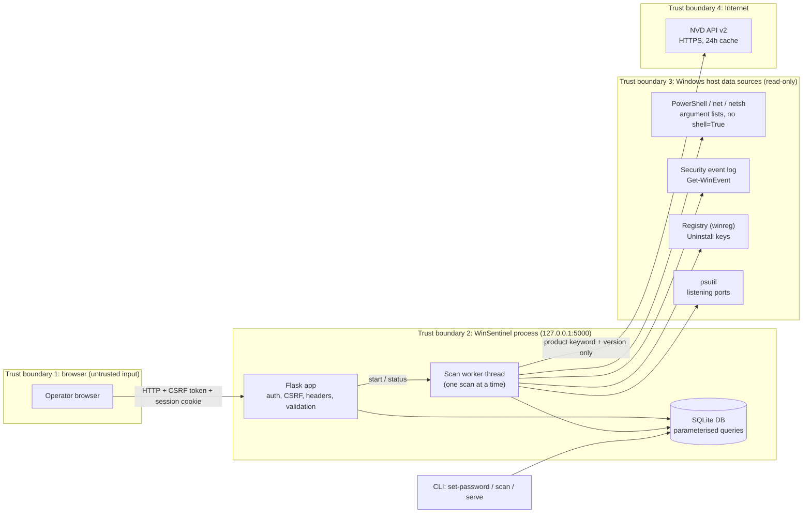

# WinSentinel Threat Model (STRIDE)

Method: STRIDE applied to each trust boundary of the data-flow diagram below (OWASP Threat Modeling / Microsoft SDL style).
Scope: the WinSentinel application running on one Windows host that the operator owns. WinSentinel is **read-only** and audits **only the local machine**.

## 1. Assets

| # | Asset | Why it matters |
|---|---|---|
| A1 | Audit results (findings, alerts, software inventory) | Reveals exactly how the host is weak; valuable to an attacker |
| A2 | Admin password hash (`users` table) | Gives access to A1 |
| A3 | Session cookie / `SECRET_KEY` | Forging it bypasses authentication |
| A4 | Windows Security event log content | Contains account names and source IPs |
| A5 | Integrity of the risk score and reports | Operators act on them; a falsified "clean" result is dangerous |
| A6 | NVD API key (optional) | Rate-limit quota; low value but must not leak |

## 2. Data-flow diagram and trust boundaries

Data that crosses boundary 4 is limited to the allowlisted product CPE name sent to NVD. No hostnames, usernames, IPs or findings leave the machine.

## 3. STRIDE analysis

### 3.1 Browser to Flask (boundary 1)

| STRIDE | Threat | Mitigation in code | Residual risk |
|---|---|---|---|
| **S**poofing | Attacker guesses or brute-forces the admin password | scrypt hashing; 12-character minimum; lockout after 5 failures for 5 minutes (`web/auth.py`); every attempt logged to `winsentinel.log` | Lockout is per client IP and held in memory (resets on restart) |
| **S**poofing | Forged session cookie | `SECRET_KEY` from `.env`; no hardcoded fallback (random per-run key if missing); `HttpOnly`, `SameSite=Lax`; 30-minute inactivity timeout | Cookie is not `Secure` because the app is served over plain HTTP on loopback |
| **T**ampering | CSRF: another site triggers a scan or logout | Flask-WTF `CSRFProtect` on every POST; logout is POST-only | None known |
| **T**ampering | Open redirect after login (`?next=https://evil`) | `safe_next_url()` accepts only same-site relative paths | None known |
| **T**ampering | SQL injection via filters / `scan_id` | Parameterised queries only; allow-lists for severity, module, status; integer validation for ids (`web/security.py`) | None known |
| **R**epudiation | Admin denies a login or scan | Login success, failure, lockout and logout are timestamped in `winsentinel.log`; scans are stored with start/finish time and host | Log file is not tamper-evident |
| **I**nformation disclosure | XSS steals data or session | Jinja autoescape; strict CSP (`script-src 'self'`, no inline script or style); no `|safe` on scan data; vendored Chart.js | `|safe` is used only for the static icon set |
| **I**nformation disclosure | Cached or framed sensitive pages | `Cache-Control: no-store` for authenticated pages and JSON/CSV; `X-Frame-Options: DENY`; `frame-ancestors 'none'`; `Referrer-Policy: no-referrer`; `Permissions-Policy`; COOP/CORP | None known |
| **I**nformation disclosure | Stack traces in responses | Custom 400/404/405/500 handlers; `debug=False` hard-coded | None known |
| **D**enial of service | Large requests or scan spam | `MAX_CONTENT_LENGTH` 64 KB; one scan at a time (lock returns HTTP 409) | A logged-in admin can still queue scans back to back |
| **T**ampering | Forged risk-register decision (hide a real finding) | `POST /api/findings/status` requires login and CSRF token; module and status are allow-listed; the finding must exist in the given scan; accepting or marking a false positive needs a written justification; every decision stores the username and time, and is shown in the UI and reports | A logged-in admin can still accept a real risk (by design, but it is audited) |
| **R**epudiation | Admin denies accepting a risk | Decisions record `updated_by` and `updated_at`, and appear in the HTML and PDF reports | Log not tamper-evident |
| **D**enial of service | Auto-scan loop overloads host or NVD | Disabled by default; minimum 15-minute interval; reuses the single-scan lock | None known |
| **I**nformation disclosure | Command palette search leaks data | `/api/search` requires login, length-limited query, parameterised LIKE, returns titles only | None known |
| **E**levation of privilege | Reaching dashboard routes unauthenticated | `@login_required` on every data route and API; test suite asserts each protected path redirects to login | Single-admin model: no roles |

### 3.2 Scan worker to Windows host (boundary 3)

| STRIDE | Threat | Mitigation | Residual risk |
|---|---|---|---|
| **S** | Malicious `net.exe` / `powershell.exe` earlier on PATH | Fixed command names invoked with argument lists; run from the operator's own account | PATH hijack requires prior local compromise |
| **T** | Command injection | `subprocess` with argument lists, `shell=False`, no user input in commands; PowerShell passed via `-EncodedCommand` with only integer parameters interpolated | None known |
| **T** | Tool changes system state | Design is read-only: no `Set-*`, no registry writes, no remediation | None |
| **I** | Event-log data (usernames, IPs) exposed | Stored only in the local database; shown only after login | Database file is not encrypted at rest; protect with NTFS permissions / BitLocker |
| **D** | A hung command blocks the scan | Per-command timeouts; failing check becomes an `error` finding, never a crash | Slow NVD queries lengthen the scan |
| **E** | Tool requires Administrator | Elevation is checked and clearly reported; checks degrade to `error` status without it | Running elevated increases the impact of any bug in the app |

### 3.3 Scan worker to NVD (boundary 4)

| STRIDE | Threat | Mitigation | Residual risk |
|---|---|---|---|
| **S** | Spoofed NVD response | HTTPS with certificate verification (requests default) | Trust in NVD and the system CA store |
| **T** | Crafted response abuses the parser | Only expected JSON fields read; descriptions truncated to 500 characters; rendered with autoescape | None known |
| **I** | Leaking host details | Only the product's CPE name is sent; API key read from `.env`, never logged or committed (`.gitignore`) | NVD sees which products are installed |
| **D** | Rate limiting / offline | Throttle delay, 24h cache (including "no CVE" answers), timeouts; offline becomes an `error` finding | CVE coverage is skipped while offline |
| **T** | False positives or negatives in CVE matching | Exact CPE vendor:product mapping, version-range check, limitation notice shown with each finding | Allowlisted products only; NVD data gaps remain |

### 3.4 Integrity of results (A5)

| Threat | Mitigation | Residual risk |
|---|---|---|
| Falsified "clean" result because a check silently failed | Every check returns pass, fail or **error**; errors are shown, not hidden, and do not count as passes | Posture score ignores errors by design, so review them |
| Direct edit of the SQLite file | File stays on the local disk of the owner | No signing of results |

## 4. Abuse cases tested

| Abuse case | Automated test (`tests/test_web.py`, `tests/test_validation.py`) |
|---|---|
| Open the dashboard without logging in | `test_protected_pages_redirect_to_login` |
| POST login or scan without CSRF token | `test_login_requires_csrf_token`, `test_scan_start_requires_csrf` |
| `?next=https://evil.example`, `//evil`, `javascript:` | `test_open_redirect_is_blocked` |
| Guess the password repeatedly | `test_lockout_after_repeated_failures` |
| Log out via a cross-site GET | `test_logout_is_post_only_and_csrf_protected` |
| SQL injection and script tags in query parameters | `test_findings_filters_and_bad_params` |
| Spreadsheet formula injection through the CSV export | `test_csv_export_neutralises_formulas` |
| Header injection through the hostname in the download name | `test_report_download_filename_is_sanitised` |
| Forge or malformed risk-register decisions | `test_register_requires_csrf`, `test_register_validation` |
| Hide a finding without a reason | `test_register_validation` (justification required) |
| Inline script or external resource slipping into a page | `test_login_success_and_every_page_renders`, `test_no_external_urls_in_pages` |

## 5. Out of scope

Remote scanning, exploitation, Active Directory auditing, automatic remediation, multi-user roles, and protection against an attacker who already controls the operator's Windows account.
